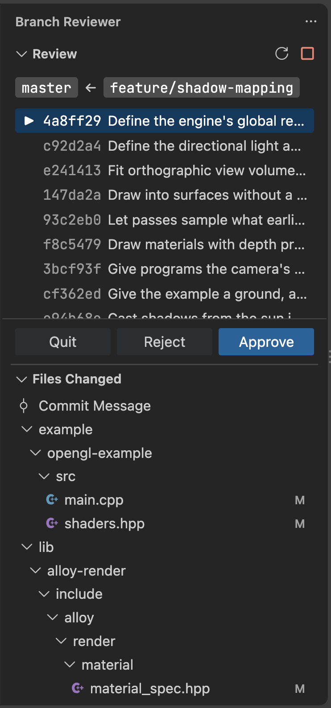

# Branch Reviewer

A simple extension to enable reviewing a local branch, one commit at a time,
and promote commits back to your base branch.



> [!NOTE]
>
> This tool was authored by a different tool that goes by the name of Claude.
> I have not vetted the quality or accuracy of the code; I use this tool so that
> I can vet the quality and accuracy of other code that I do care about. It
> works as the tool I need it to be, and I'm sharing this in case anyone else
> can benefit from it.

## Features

* **Review and approve by commits** \
  Every commit gets reviewed independently and is approved independently.
  When a commit is approved, it gets fast-forwarded back onto the base branch.

* **Filter changed files** \
  During a review, the files that have been modified -- and how they are
  modified -- are all displayed in its own handy 'files changed' panel.

* **Reword commits** \
  Did Claude/Codex/Deepseek write some heavy slop-filled message that you can't
  stand to read? You can edit the `COMMIT_MESSAGE` before promoting commits to
  avoid a hefty serving of word-salad.

* **Edit changes** \
  Did your slop-as-a-service tool write bad code that you want fixed before it
  is immortalized in your history? Now is the time to shout at it. You can
  reject a commit and edit it locally, which just brings up the standard
  `git rebase` in edit mode so that it can be fixed.

## Starting a review

> [!WARNING]
>
> Everything below this line is written by Claude. It's correct, but it's also
> a heaping serving of slop. Be warned.

Open the **Branch Reviewer** icon in the activity bar.

1. In **Review**, choose a **base** branch (by default the repository's
   default branch) and a **head** branch (by default the branch that is
   checked out).
2. Press **Review**.

The head branch must already be rebased onto the base, and it must not
contain merge commits. Otherwise the review is refused with an error.

## Reviewing a commit

The panel lists the commits from oldest to newest and highlights the one
under review. That commit's message opens in an editor as
`COMMIT_EDITMSG`, so it gets the usual git commit message support.

| Button | Effect |
| --- | --- |
| **Approve** | Fast-forwards the base branch onto the commit and moves on to the next one. If you edited the message, or the commit isn't signed, the commit is first re-created with a signature (using your configured signing key), and the rest of the branch is replayed to check for conflicts before the base moves. Approved commits are grayed out with a ✓. |
| **Reject** | Shows **Cancel** (go back), **Edit** (pause the rebase), and **Abandon** (`git rebase --abort`). |
| **Quit** | Replays the remaining commits unchanged and ends the review. Commits approved so far stay on the base branch. |

Use **Refresh** and **Abort** in the panel title bar. Abort is the same
as `git rebase --abort`, and it always resets the review, even if git
reports an error.

### Editing history

**Reject → Edit** pauses the rebase on the current commit. You can amend
it or add new commits with any git tool. **Resume** replays the rest of
the branch, reloads the commit list, and continues with the first
commit that hasn't been reviewed.

### Conflicts

If replaying the branch hits a conflict, the panel darkens. Resolve the
conflict, stage the result, and press **Continue**. The action that was
interrupted (an approval, a resume, or a quit) then finishes.

### Uncommitted changes

Before any step that continues the rebase, a warning offers **Autostash**
or **Cancel** if there are uncommitted changes. Autostashed changes are
restored when the review ends.

### Changes made elsewhere

The extension watches the git directory (it never polls). If the rebase
is aborted from elsewhere, a branch is checked out, or the base branch
moves, the panel darkens and explains why the review was stopped.

## Files Changed

This view shows the working tree at the commit under review, laid out
like the Explorer. The first entry opens the commit message.

- The names of files and folders the commit changed are colored: green
  for added, yellow for modified, red for deleted. The colors can be
  overridden through `workbench.colorCustomizations` using the
  `branchReviewer.*Foreground` color IDs.
- The filter button in the title bar switches between showing every
  file and showing only the changed ones.
- The inline action on a changed file opens its diff against the
  parent commit.

Open editors also mark the lines the commit changed in the gutter.

## Status and logs

The status bar shows the stage of each running operation, such as
`Rebasing 4/10`. Click it to open the **Branch Reviewer** log.

## Limitations

- Only the first workspace folder's repository is reviewed.
- The Files Changed view doesn't apply `files.exclude`.
- In a linked worktree, moves of the base branch are noticed only on
  the next repository event.

## Development

```sh
npm install
npm run compile
npm run test:unit         # node:test, all git and editor access mocked
npm run test:integration  # VS Code host against a temporary repository
```

`test:integration` downloads VS Code. Alternatively, set
`VSCODE_EXECUTABLE_PATH` to a local installation that isn't currently
running.
